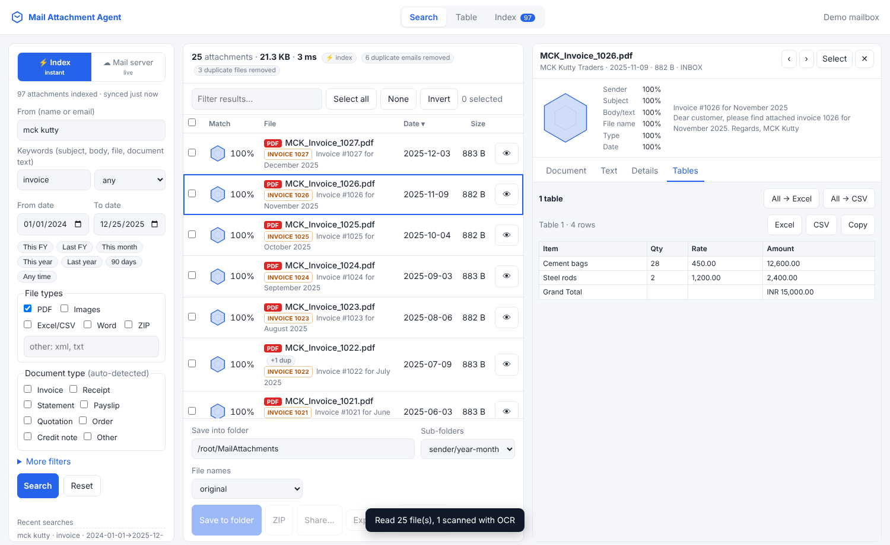

# parthag

## Mail Attachment Agent



Finds email attachments fast, lets you **preview** them, **select several**, and
**download into an organised folder**, with no duplicates.

> Example: *all invoices from MCK Kutty between 1 Jan 2024 and 25 Dec 2025, as PDF.*

Works with **Gmail, Outlook/Hotmail/Microsoft 365, Yahoo, Zoho, iCloud, Rediffmail** or any
IMAP mailbox. It is **read-only**: nothing is deleted, moved or marked as read.

### Windows app (recommended)

1. On GitHub open **Actions → "Windows app"**, click the latest green run, and download
   **MailAttachmentAgent-Windows-…** from *Artifacts* at the bottom of the page (unzip it).
   For a tagged version (`v1.0.0` …) the files are also on the **Releases** page.
2. Run **`MailAttachmentAgent-Setup-….exe`**. No administrator rights are needed. If Windows SmartScreen
   says "Windows protected your PC", click **More info → Run anyway** (the app isn't code-signed).
3. Start **Mail Attachment Agent** from the Start menu or desktop. It opens in its own window.
   The **"(demo mailbox)"** shortcut lets you practise without logging in.

The desktop app adds a **Browse…** button for the download folder, a native **Save as** dialog for
ZIPs, an **Open folder** button after saving, and **Remember me**, which keeps your password in the
*Windows Credential Manager*, not in a file. Uninstall it from *Settings → Apps*.

Prefer no installer? Use **`MailAttachmentAgent-Portable-….zip`**: unzip it anywhere and run `MailAgent.exe`.
If you have Python, you can also run from source by double-clicking `windows\Start-MailAgent.bat`,
or build the exe yourself with `windows\build.ps1`.

Needs Windows 10 or 11 (64-bit) with the Microsoft Edge WebView2 runtime, which is built into Windows 11
and recent Windows 10.

### Quick start (any OS, runs in your browser)

```bash
pip install -r requirements.txt
```

```bash
python -m mail_agent web --demo
```

`--demo` opens the browser UI with a built-in sample mailbox, so you can try everything
without logging in. Drop `--demo` to use your real mailbox:

```bash
python -m mail_agent web
```

Then pick your provider, enter your email and an **App Password** (Gmail: turn on 2-step
verification, then go to <https://myaccount.google.com/apppasswords>). Your normal password won't work
with IMAP. You can also put the login in a `.env` file (copy `.env.example`).

### Using the screen

1. **Search** (left): sender (name *or* email, e.g. `mck kutty`), keywords (`invoice, bill`),
   date range (quick buttons for this/last financial year), file types.
   *More options*: exclude words, choose folders, **search inside PDF text**, show inline images,
   minimum match score.
2. **Results** (middle): click a row to **preview** it (PDF, images or text; the *Text* tab shows the
   PDF's text). Use **↑/↓** to move between files, **Space** to select, **Shift-click** to select a range,
   and *Select all / None / Invert* and the filter box.
3. **Download** (bottom): choose the destination folder and layout
   (`sender/year-month`, `year/month`, `flat`, ...) and file naming
   (`original`, `date + original`, ...). Then **Save to folder** or **Download ZIP**.

Every folder gets a `manifest.csv` (file, sender, subject, email date, SHA-256), and each saved
file's date is set to the date of its email.

### Command line

```bash
python -m mail_agent search --from "mck kutty" -k invoice --since 2024-01-01 --until 2025-12-25 -t pdf --save ~/Invoices
```

The command lists the matches, then asks which to download (`1,3,5-9`, `all`). Add `--yes` to
download everything, `--deep` to also search inside PDF text, and `--provider gmail` to skip
setting `MAIL_HOST`.

### How it finds exactly the right files, fast

| Technique | What it does |
|---|---|
| **Query matrix (square mapping)** | The search is split into a grid of **date windows × senders × folders**. Each cell is a small search run *on the mail server*, all cells run **in parallel** over a pool of IMAP connections (default 6). Cells overlap by a day so timezone edges are never missed. Results are merged as a set, so overlaps never create duplicates. |
| **Gmail native search** | For Gmail it uses Gmail's own search (`X-GM-RAW`), so sender, keyword, **attachment file name**, type and date are all filtered by Google before anything is downloaded. |
| **Structure-only fetch** | It reads only each email's MIME structure, four headers and the first ~2 KB of text. Attachment bytes are downloaded **only** when you preview or save, and only that one part, never the whole email. Previewed files are cached, so saving them afterwards is instant. |
| **Hexagon scoring** | Every attachment is checked on six sides: **sender, subject, body/PDF text, file name, file type, date**. Each side scores from 0 to 100%. Date and type must match exactly, the sender must match, and the keyword must appear in at least one of subject / body / file name. Matching tolerates typos and initials (`M.C.K Kuty` matches `mck kutty`). The hexagon drawn next to each result shows *why* it matched. |
| **3-level de-duplication** | ① the same email in several folders or labels (Message-ID) → shown once. ② the same file sent again in a reminder or forward (name + size) → shown once, with a "+1 dup" badge. ③ when saving, the **SHA-256 of the content** is checked against everything already in that folder → identical files are never written twice, even across runs. |

### Safety

* The web UI listens on `127.0.0.1` only and rejects other host names and non-JSON POSTs.
* Your password is kept in memory only, unless you choose to put it in `.env`, which is git-ignored.
* HTML and other non-safe attachments are previewed as plain text, so they can never run scripts.
* Saved file names are sanitised, so an attachment can never be written outside the folder you chose.

### Tests

```bash
python -m pytest -q
```
