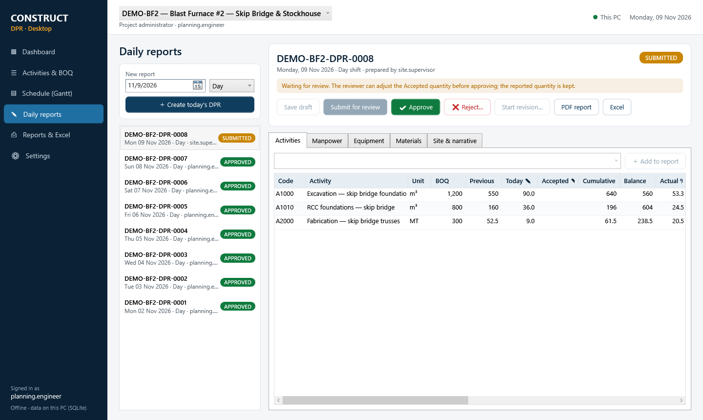
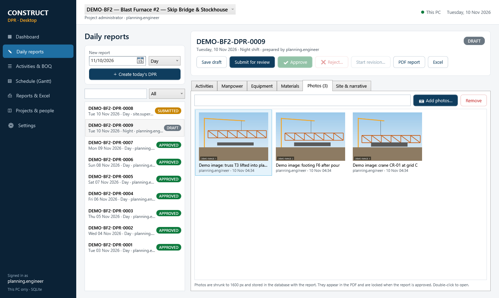
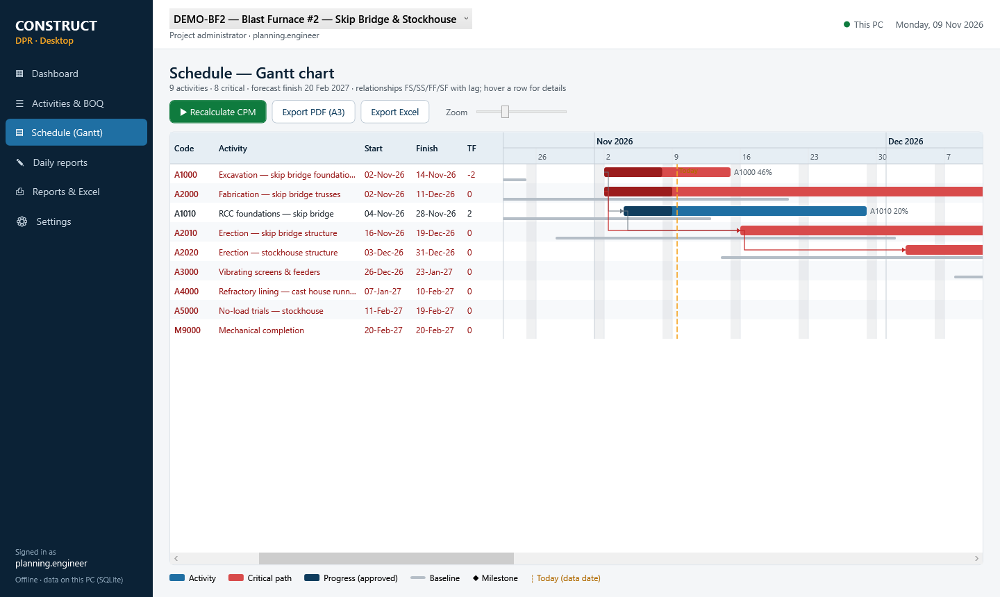
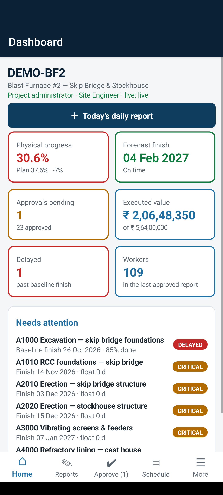
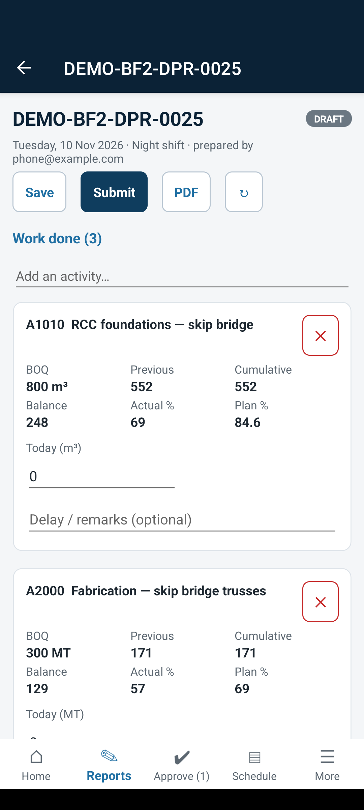
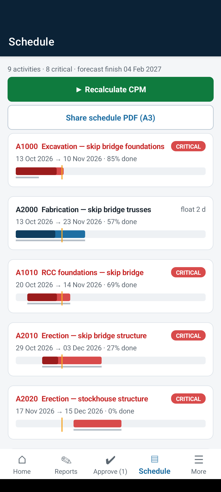

# CONSTRUCT DPR

**Construction daily progress reporting and site management** for industrial projects: structural steel, mechanical erection, piping, refractory, civil, testing and commissioning.

Everything is **C# (.NET 10)**:

| Part | Built with | Install |
|---|---|---|
| **Windows app** | **WPF**, with a native Gantt chart | `CONSTRUCT-DPR-windows-setup.exe` |
| **Android app** | **.NET MAUI**, native screens written in C# | `CONSTRUCT-DPR-android.apk`, installed directly |
| **Database** | **Microsoft SQL Server** (SQL Server Express is free), or SQLite for one PC offline, through EF Core | your office PC/server |
| **Sync server** (only for phones) | ASP.NET Core API + SignalR live updates, using the same SQL Server database | `CONSTRUCT-DPR-server-windows.zip` |
| **Rules** | CPM scheduling, approvals, roles and checks, in one shared C# library | |
| **Reports** | QuestPDF (PDF), ClosedXML (Excel) | |

```
 Office PCs ── Windows app (WPF) ──────────────┐
                                               ├──►  Microsoft SQL Server  (one database)
 Phones ──── Android app (MAUI) ── Sync server ┘
```
Changes on any PC or phone appear on all others within a few seconds.

**Windows (WPF)**

| Report review | Site photos | Gantt chart |
|---|---|---|
|  |  |  |

**Android (.NET MAUI)**

| Home | Report review | Schedule |
|---|---|---|
|  |  |  |

## Get started

* **One PC, no set-up:** install **CONSTRUCT-DPR-windows-setup.exe** from the *Releases* page. It opens offline with a demo project.
* **Office and phones:** follow [docs/START_HERE.md](docs/START_HERE.md): SQL Server Express → Windows app → sync server → Android app.

## What it does

| Area | Highlights |
|---|---|
| **Daily progress report** | Today's quantity per activity with live previous / cumulative / balance / actual % / planned %, overrun blocked. Manpower by agency and trade, equipment hours and breakdowns, material stock, weather, narrative, safety. Crews are copied from the previous report |
| **Site photos** | Camera (phone) or files (PC), shrunk before upload, stored in SQL Server, printed in the PDF, locked on approval |
| **Approvals** | Draft → submit → approve (the reviewer may lower the *accepted* quantity) or reject (reason required) → revise. No self-approval unless allowed. Approved reports are locked with a SHA-256 fingerprint, and tampering is detected |
| **Schedule** | Activities and BOQ, FS/SS/FF/SF with lag, CPM with data date and actual dates, critical path, numbered baselines, Gantt chart |
| **Dashboard** | Physical progress against plan, S-curve, forecast finish, executed value (₹), approvals pending, delayed and critical activities |
| **Reports & Excel** | DPR PDF (A4), schedule PDF with Gantt (A3), Excel exports, Excel import that rejects the whole file if any row is wrong, audit trail |
| **People & roles** | 13 roles × 7 modules × 8 actions ([docs/PERMISSIONS.md](docs/PERMISSIONS.md)), checked for every action |
| **Two people, one record** | A stale copy is refused instead of silently overwriting a colleague's newer work |

## For developers

```bash
dotnet test tests/ConstructDpr.Tests                  # 49 tests; set CDPR_SQLSERVER="Server=…" to include SQL Server
dotnet run --project src/ConstructDpr.App             # Windows app (on Windows)
dotnet build src/ConstructDpr.Mobile -f net10.0       # compiles the Android app's C# on any PC
dotnet build src/ConstructDpr.Mobile -f net10.0-android   # the .apk (needs: dotnet workload install maui-android + Android SDK)
dotnet run --project src/ConstructDpr.Server          # sync server on http://localhost:5080
```

```
src/
  ConstructDpr.Shared/   entities, CPM, Gantt layout, progress maths, permissions, the API contract
  ConstructDpr.Core/     EF Core (SQL Server / SQLite / PostgreSQL), workflow, LocalApi (all rules), office accounts
  ConstructDpr.Reports/  QuestPDF and ClosedXML documents
  ConstructDpr.App/      Windows app (WPF): This PC · Office SQL Server · Sync server
  ConstructDpr.Mobile/   Android app (.NET MAUI, C# screens)
  ConstructDpr.Client/   sign-in, RemoteApi and live updates used by the Android app (and the Windows app in sync-server mode)
  ConstructDpr.Server/   sync server (ASP.NET Core API + SignalR)
tests/                   xUnit tests
tools/                   sample report generator
installer/               Inno Setup script for the Windows installer
```

## Licence

Apache-2.0. Third-party components: [THIRD_PARTY_LICENSES.md](THIRD_PARTY_LICENSES.md). QuestPDF is free under its Community licence for organisations with under USD 1 million annual revenue; larger companies need a QuestPDF commercial licence.
