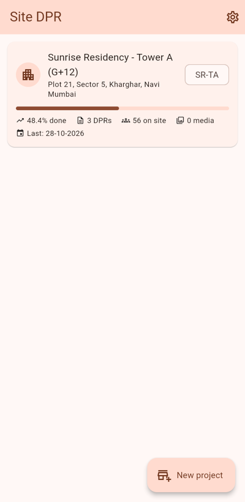
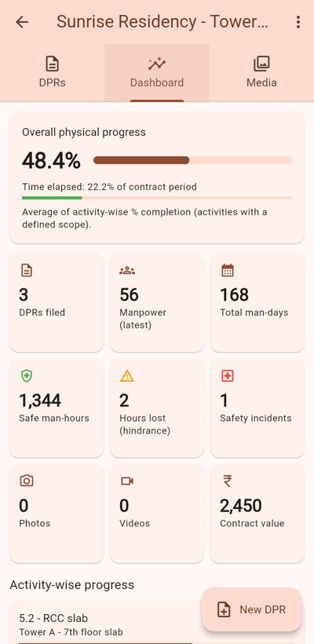
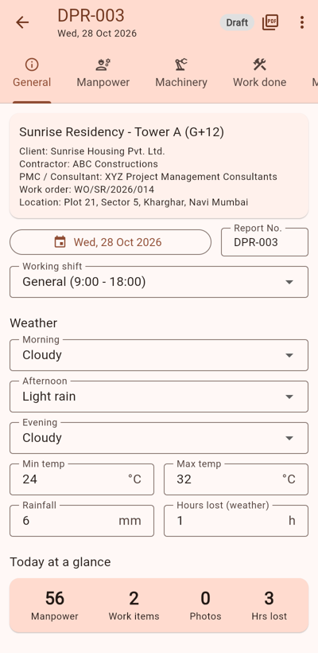
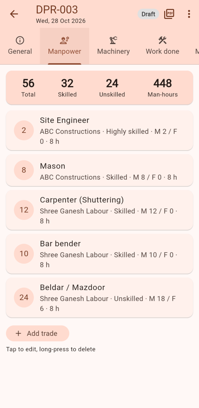
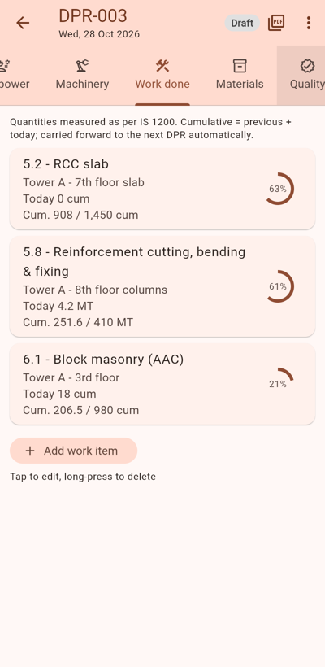
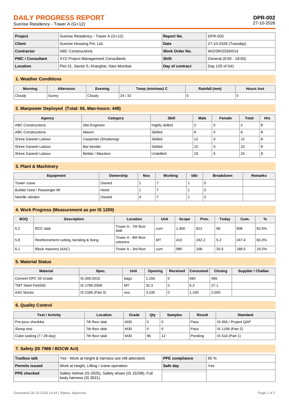

# Site DPR – Daily Progress Report app for construction sites

A Flutter (Google) mobile app for Android and iOS that lets site engineers record the **Daily Progress Report (DPR)** of a construction project the way Indian sites do it: IS-code units and specs, a hindrance register, safety records under the BOCW Act, geo-tagged photos and videos, signatures, and a PDF ready to print or share on WhatsApp.

It works fully **offline** on site. You can optionally turn on **Google sign-in and cloud sync** through Firebase.

| Projects | Dashboard | DPR – General | DPR – Manpower | DPR – Work done | PDF |
|---|---|---|---|---|---|
|  |  |  |  |  |  |

## Features

**Projects**
- Project master: client, contractor, PMC/consultant, work order/LOA no., contract value (₹ lakh), start and completion dates.
- Dashboard: overall physical progress compared with time elapsed, man-days, safe man-hours, hours lost to hindrances, incidents, and activity-wise progress bars.
- "Try with a sample project" loads a G+12 tower with 3 days of DPRs so you can explore the app.

**Daily Progress Report** (10 sections)

| Section | What it records | Standard / practice |
|---|---|---|
| General | Date, DPR no., shift, weather for morning/afternoon/evening, temperature, rainfall (mm), hours lost | IMD-style weather log |
| Manpower | Agency-wise trades with Hindi names (Mistri, Beldar, Reja…), male/female split, hours, man-hours | Skill classes as per the Minimum Wages Act |
| Machinery | Owned/hired equipment with working, idle and breakdown hours | – |
| Work done | BOQ/DSR item, location (block/floor/grid), unit, scope, previous, today, cumulative, % complete | Units as per **IS 1200** |
| Materials | Opening + received − consumed = closing stock, supplier, challan/MRN no. | **IS 269, 1489, 1786, 383, 4926, 2185, 12894** … |
| Quality | Pour records, slump, cube casting, sieve analysis, steel tests, checklists, pass/fail | **IS 456, 516, 1199, 2386, 1608, 3495, 2720** |
| Safety | Toolbox talk, PPE compliance %, PPE checklist, work permits, incidents (near miss → LTI), safe-day logic | **IS 7969, IS 3764, BOCW Act 1996**, PPE to IS 2925/3521/15298 |
| Hindrance | Category, hours lost, responsibility (client / contractor / PMC / force majeure), action required, plus visitors | CPWD-style hindrance register (supports EOT claims) |
| Photos & videos | Camera or gallery, multi-select, time-stamp, **GPS geo-tag**, caption, category, **tags**, site location, link to a work item | – |
| Notes & sign-off | Instructions from client/PMC, remarks, plan for tomorrow, **on-screen signatures** (prepared, checked, approved), Draft → Submitted → Approved workflow (approved reports are locked) | – |

**Smart carry-forward:** when you start a new DPR, the app can copy manpower, machinery and work items from the previous report. Cumulative quantities roll forward, and yesterday's closing stock becomes today's opening stock.

**Media library:** every photo and video in the project, with filters by type, category and tag. It has a full-screen viewer with pinch-zoom and video playback, and you can share or edit tags from it.

**Output**
- **PDF** on A4 in CPWD/PWD style: header block, every section as a table, a photo grid with captions, tags, time and GPS, a video register, and signature blocks. You can preview, print or share it.
- **WhatsApp summary:** a plain-text DPR formatted with WhatsApp bold markers that you can share in one tap.
- Indian formats throughout: DD-MM-YYYY dates and lakh/crore digit grouping (1,23,456).

**Storage and sync**
- Offline first: data is kept as JSON in the app's private storage, and photos and videos are copied into app storage, so clearing the gallery doesn't lose them.
- Optional Google cloud: sign in with Google through Firebase Auth. Reports sync to Cloud Firestore and media goes to Firebase Storage, so the whole site team can share it across devices.

## Download & install

Ready-made builds are on the **[Releases page](https://github.com/garthag/parthag/releases/latest)**:

| File | For |
|---|---|
| `SiteDPR-android.apk` | Android phones and tablets (recommended for site use: camera, video, GPS) |
| `SiteDPR-windows.zip` | Windows 10 / 11 PCs (office use: review, add photos from files, print PDFs) |

### Windows PC

1. Open the [Releases page](https://github.com/garthag/parthag/releases/latest) and click **`SiteDPR-windows.zip`** to download it.
2. In your **Downloads** folder, right-click the zip and choose **Extract All… → Extract**.
3. Open the extracted **`SiteDPR`** folder and double-click **`site_dpr.exe`**.
4. If Windows shows **"Windows protected your PC"**, click **More info → Run anyway**. The app isn't code-signed, so Windows shows this warning for any new app.
5. Optional: right-click `site_dpr.exe` and choose **Show more options → Send to → Desktop (create shortcut)**.

Keep the whole `SiteDPR` folder together: the `.exe` needs the `data` folder and the `.dll` files next to it. You can move the folder anywhere, for example to `C:\Program Files` or your Documents folder.

If the app doesn't start and complains about a missing `MSVCP140.dll` or `VCRUNTIME140.dll`, install the [Microsoft Visual C++ Redistributable (x64)](https://aka.ms/vs/17/release/vc_redist.x64.exe) and try again.

On Windows, photos and videos are added from files (**Gallery** / **Video file**), because there's no camera capture, and in-app video playback may not be available. For site work with the camera and GPS, use the Android app.

### Android phone

1. On the phone, open the [Releases page](https://github.com/garthag/parthag/releases/latest) and tap **`SiteDPR-android.apk`**.
   (Or download it on a PC and copy it to the phone over USB, WhatsApp or Google Drive.)
2. Open the downloaded file. If Android asks, allow **Install unknown apps** for your browser or file manager.
3. Tap **Install**, then **Open**.

## Building from source

Prerequisites: the [Flutter SDK](https://docs.flutter.dev/get-started/install) (stable) and Android Studio or the Android SDK.

```bash
flutter pub get
flutter run              # on a connected phone or emulator
flutter build apk        # release APK: build/app/outputs/flutter-apk/app-release.apk
flutter build windows    # on a Windows PC with Visual Studio (Desktop C++): build/windows/x64/runner/Release
```

Each push also triggers the GitHub Actions workflow (`.github/workflows/build.yml`). It runs the analyzer and tests, builds the Android APK and the Windows app, and publishes both on the Releases page.

## Enable Google cloud sync (optional)

1. Create a project in the [Firebase console](https://console.firebase.google.com/).
2. Enable **Authentication → Google**, **Cloud Firestore** and **Storage**.
3. Connect the app:
   ```bash
   dart pub global activate flutterfire_cli
   flutterfire configure        # creates lib/firebase_options.dart and google-services.json
   ```
4. In `lib/services/cloud_sync.dart`, change `Firebase.initializeApp()` to
   `Firebase.initializeApp(options: DefaultFirebaseOptions.currentPlatform)` and import `../firebase_options.dart`.
5. For Android Google sign-in, add your SHA-1 fingerprint (`cd android && ./gradlew signingReport`) in the Firebase project settings.
6. Suggested security rules, which give each user access only to their own data:
   ```
   // Firestore
   match /users/{uid}/{document=**} { allow read, write: if request.auth.uid == uid; }
   // Storage
   match /users/{uid}/{allPaths=**} { allow read, write: if request.auth.uid == uid; }
   ```

Until Firebase is configured, the app runs in offline mode and the Settings screen says so.

## Project structure

```
lib/
  main.dart                  App entry, theme, providers
  models/models.dart         Project, DailyReport and all section models (JSON)
  data/standards.dart        IS-code catalogues: trades, materials, activities, tests, PPE, permits…
  data/local_store.dart      Offline JSON store
  data/sample_data.dart      Demo project
  state/app_state.dart       Projects/reports state, carry-forward, dashboard summary
  services/media_service.dart  Camera/gallery, geo-tagging, file storage
  services/pdf_service.dart    PDF report
  services/report_text.dart    WhatsApp text summary
  services/cloud_sync.dart     Google sign-in + Firestore/Storage sync
  screens/                   Home, project, DPR editor, media gallery/viewer, settings
  widgets/                   Section editors, generic entry form, shared widgets
test/                        Model, state, PDF and widget tests
```

## Tests

```bash
flutter analyze
flutter test
```
