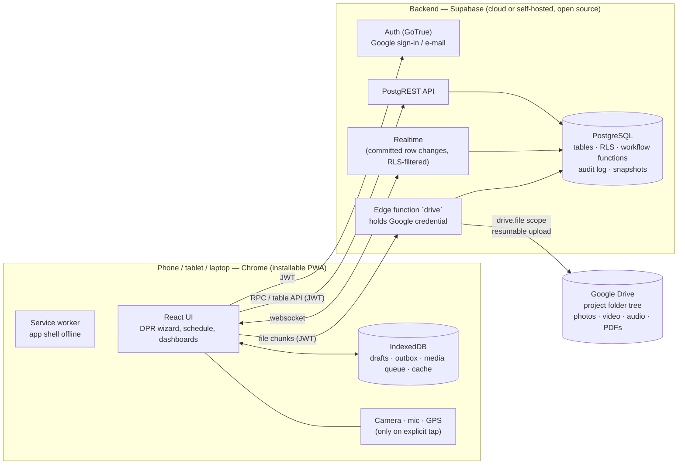
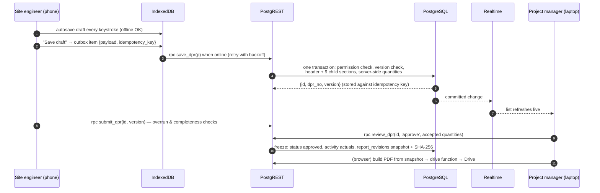

# Architecture

## 1. System architecture

**Key decisions**

| Decision | Why |
|---|---|
| PostgreSQL for all structured records; Google Drive for files only | Relational integrity, transactions, row-level security, audit — none of which Sheets/Drive provide. Drive is cheap, familiar storage for large media. |
| Business rules live **in the database** (RLS + security-definer functions) | The browser is never trusted. The same rules apply to the app, the API, scripts and any future client. |
| Approved DPR = immutable JSON snapshot + SHA-256 | A report, once approved, can always be reproduced exactly, even after BOQ/masters change. |
| Drive access through a server function holding one document-controller credential | With the narrow `drive.file` scope each *user's* token can only see files *that user's* session created, which breaks a shared project tree. A single server-held credential keeps one tree, keeps secrets off phones, and lets the database decide who may upload/view. |
| Offline-first client with outbox + idempotency keys | Site networks drop; retries must never duplicate a DPR. |
| CPM engine in TypeScript on the client | Deterministic, unit-tested, works offline; results are written back only through `apply_schedule_dates()` with version checks. |

## 2. Request flow for a DPR

## 3. Components

| Layer | Path | Notes |
|---|---|---|
| Database schema & rules | `supabase/migrations/*.sql` | 8 ordered migrations; see [DATABASE.md](DATABASE.md) |
| DB acceptance tests | `supabase/tests/` | Run against plain PostgreSQL with a Supabase shim |
| Drive gateway | `supabase/functions/drive/` | `core.ts` is runtime-agnostic and unit-tested |
| Web app | `web/src` | `lib/` logic (sync, CPM, calc, voice, pdf), `pages/`, `components/` |
| Unit tests | `web/src/__tests__` | progress maths, money, stock, CPM, S-curve, voice, Drive, sync |

## 4. Data freshness and status shown to users

The status bar always shows **database** sync and **file upload** status separately:
*Saved locally → Waiting to synchronise → Synchronising → Synchronised*, or *Sync failed / Conflict requires review*; files: *Waiting / Uploading n% / In Drive / Upload failed*.
Dashboards state their date range, unit, method and data time.

## 5. What the system deliberately does not claim

* No "instant" sync or "zero data loss": devices can be offline for days and browsers can evict storage.
* No regulatory certification from permit checklists.
* No proof of authenticity from device time, GPS or EXIF.
* No native Primavera P6 compatibility (CSV exchange is documented and tested only for the columns listed in [P6_EXCHANGE.md](P6_EXCHANGE.md)).
