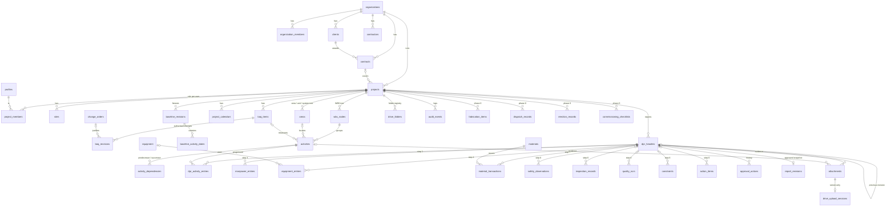

# Database design

PostgreSQL 15+ (Supabase). UUID primary keys, foreign keys everywhere, `numeric` for money (18,2) and quantities (18,4), `timestamptz` in UTC with the project's reporting timezone stored separately (`projects.timezone`). Every master/transaction table has `created_at, created_by, updated_at, updated_by, version, status` and an audit trigger.

## Entity–relationship diagram (core)

## Tables (all required entities)

| Area | Tables |
|---|---|
| Identity & tenancy | `profiles` (1:1 with `auth.users`), `organizations`, `organization_members`, `project_members`, `role_permissions`, `project_role_permissions` |
| Masters | `clients`, `contracts`, `contractors`, `projects`, `sites`, `areas`, `wbs_nodes`, `activities`, `activity_dependencies`, `project_calendars`, `equipment`, `materials` |
| Planning | `baseline_revisions`, `baseline_activity_dates` (frozen; update is blocked by trigger) |
| Commercial | `boq_items`, `boq_revisions` (append-only), `change_orders` |
| DPR | `dpr_headers` (+ narrative), `dpr_activity_entries`, `manpower_entries`, `equipment_entries`, `material_transactions` |
| Registers | `safety_observations`, `inspection_records`, `quality_ncrs`, `constraints`, `action_items` |
| Workflow | `approval_steps`, `approval_actions` (no update), `report_revisions` (immutable snapshot + SHA-256; PDF reference can be set once) |
| Documents | `drive_folders` (unique per project+path → idempotent), `attachments`, `drive_upload_sessions` (no API access) |
| Sync & audit | `synchronization_jobs` (idempotency results), `audit_events` (append-only) |
| Integration | `integration_events` (append-only, ordered event feed for other software; see [INTEGRATIONS.md](INTEGRATIONS.md)) |
| Industrial (Phase 6) | `fabrication_items`, `dispatch_records`, `erection_records`, `commissioning_checklists` |

## Views (security_invoker — caller's RLS applies)

`dpr_effective` (latest *approved* revision per DPR number) · `dpr_effective_entries` · `activity_progress` · `boq_status` (amounts) · `manpower_daily` · `equipment_daily` · `material_ledger` · `material_stock`.

## Integrity rules enforced in the database

| Rule | Mechanism |
|---|---|
| One original DPR per project / date / shift / area | partial unique index `dpr_one_per_slot` |
| Approved DPRs and their rows cannot change, even by the DB owner | triggers `guard_approved_dpr`, `guard_approved_dpr_child` |
| Corrections = new revision with reason and link to previous | `start_dpr_revision()`, check constraint on `dpr_headers` |
| Cumulative ≤ approved quantity unless an authorised overrun with reason | `submit_dpr()` / `review_dpr()` + check constraint |
| Reported, inspected and accepted quantities kept separately | `qty_today`, `qty_inspected`, `qty_accepted` |
| Previous cumulative is computed by the server from approved revisions only | `prior_accepted_qty()` |
| Stock never negative; rejected ≤ received | check constraints on `material_transactions` |
| Equipment hours ≤ 24; breakdown requires a reason | check constraints |
| BOQ quantity/rate change only via `revise_boq_item()` with reason | trigger + append-only `boq_revisions` |
| Billed ≤ certified | check constraint |
| Concurrent edits detected | `version` column; workflow functions take `expected_version` |
| Retry-safe saves | `synchronization_jobs.idempotency_key` |
| Every change logged | `audit_row()` trigger → `audit_events` |

## Workflow functions (RPC)

`create_organization`, `create_project`, `add_project_member`, `set_project_member_active`, `save_dpr`, `submit_dpr`, `review_dpr` (start_review / approve / reject / comment), `start_dpr_revision`, `dpr_document`, `dpr_activity_context`, `create_baseline`, `set_current_baseline`, `apply_schedule_dates`, `revise_boq_item`, `register_drive_folder`, `set_report_pdf`, `export_project`, `my_permissions`, `load_demo_project`.

Each one checks the caller's permission first (`require_perm`) and raises `PT4xx` errors, which PostgREST maps to HTTP status codes.

## Indexes

Project id on every child table; plus `(project_id, report_date)`, `(project_id, status)`, `(project_id, activity_id)`, `(project_id, material_id, txn_date)`, `(project_id, sha256)`, audit `(project_id, occurred_at)`.
