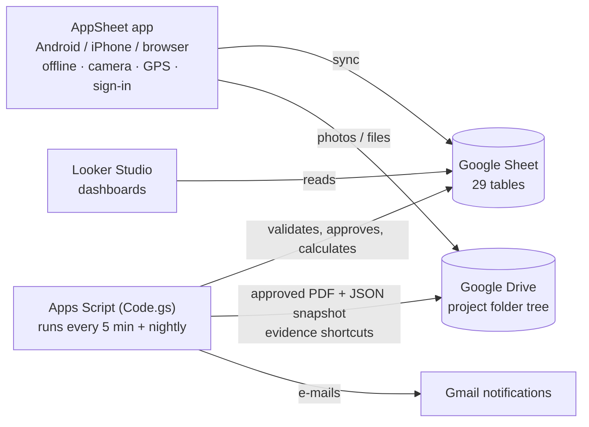

# CONSTRUCT DPR — Google Workspace edition

Everything runs inside Google: **Sheets** is the database, **AppSheet** is the phone app, **Apps Script** enforces the rules, **Drive** stores photos and PDFs, **Looker Studio** shows dashboards. No servers, no hosting, no code to edit.



## Which edition should I use?

| | **Google Workspace edition** | **Web edition** (Supabase/PostgreSQL) |
|---|---|---|
| Where data lives | Your Google Sheet + Drive | PostgreSQL database + Drive |
| Setup | ~45 min, all clicks, no hosting | ~45 min, needs Supabase + Netlify |
| Phone app | AppSheet (no-code, configurable by you) | Custom installable web app |
| Offline | Yes (AppSheet) | Yes (built in) |
| Approval rules | Enforced by the script within ~5 minutes; app buttons hide invalid actions | Enforced instantly by the database |
| Approved reports locked | PDF + JSON snapshot with SHA-256; edits to approved data are **detected** nightly and reported | Edits are **impossible** (database refuses) |
| Scale | Comfortable up to roughly 5–10 active projects / 50 users / ~100k rows; archive yearly | Large organisations |
| Dashboards | Looker Studio (free) | Built into the app |
| Customising | Change columns, forms and views yourself in AppSheet | Needs a developer |
| Costs | See below — AppSheet licence for real use | Supabase free tier, then paid hosting |

**Recommendation:** choose the Google edition if you want everything in your Google account and to customise the app without code — ideal for a pilot or a small-to-medium contractor. Choose the web edition when you need strict database-enforced controls, many projects, or many users.

## Costs (check current prices on Google's sites)

| Service | Cost |
|---|---|
| Google Sheets, Drive, Apps Script, Looker Studio | Free with any Google account, within quotas (15 GB Drive; Apps Script trigger time ~90 min/day on free accounts, ~6 h/day on Workspace; e-mails 100/day free, 1,500/day Workspace) |
| **AppSheet** | Free to build and test with up to 10 test users. Real use needs an AppSheet licence — **AppSheet Core is included in most Google Workspace business editions**; otherwise per-user AppSheet plans apply |
| Drive storage | Photos/videos fill 15 GB quickly → Google One or Workspace storage |

## What the script does for you

* **Checks on submit:**
  - date not in the future, and no duplicate report for the same date, shift and area;
  - every line belongs to the project;
  - quantity beyond the approved quantity needs an authorised overrun with a reason;
  - equipment hours ≤ 24, and breakdown hours need a reason;
  - stock warnings.

  If anything fails, the report goes back to *Draft* with the reasons shown in **Issues**.
* **DPR numbers:** `PROJECT-DPR-0001`, …
* **On approval:**
  - checks the approver role and blocks self-approval (unless the project allows it);
  - uses the **accepted** quantity, which defaults to the reported quantity;
  - calculates previous, cumulative and balance quantities, actual and planned %, and variance;
  - updates activity actual dates and status, store stock and BOQ executed amounts;
  - writes an **immutable JSON snapshot + SHA-256**;
  - creates a **PDF** in `04_DPR/YYYY/MM/Approved PDFs`;
  - adds shortcuts to the photos in the dated *Photographs* folder;
  - e-mails the preparer.
* **Rejection** needs a reason and the preparer gets an e-mail.
* **Revision** of an approved report creates a new draft revision. The original stays approved, and progress uses the latest approved revision only.
* **Voice:** dictate a sentence (phone keyboard microphone) → the script proposes activity, quantity, unit, workers and equipment → you check and confirm → lines are added.
* **Scheduling (nightly, or from the menu):**
  - CPM with FS/SS/FF/SF links, lags and holidays, giving early dates, total float and the critical path;
  - **Freeze baseline** keeps every revision.
* **BOQ revisions:** applied only when approved by an Admin or Project Manager with a reason.
* **Nightly integrity check:** if anyone edits approved data directly in the sheet, the report is flagged in **Snapshots → IntegrityOK** and Admins get an e-mail. The PDF/JSON in Drive remains the authoritative copy.
* **Looker Studio tables:** `Report_Daily` and `Report_SCurve`.

---

## Setup — step by step

Use the Google account that should **own** the data (ideally a company account such as `dpr-documents@yourcompany.com`). Field users never get direct access to the spreadsheet; they use the AppSheet app.

### Step 1 — Create the spreadsheet and paste the script (10 min)
1. Open <https://sheets.new> and name the file **CONSTRUCT DPR data**.
2. Menu **Extensions → Apps Script**. A new tab opens.
3. In the repository open **`google-workspace/dist/Code.gs`**, click **Copy raw file**, then in Apps Script select everything in `Code.gs` and paste over it.
4. Click the ⚙ **Project Settings** (left) → tick **Show "appsscript.json" manifest file in editor**. Back in the editor, open `appsscript.json` and replace its content with **`google-workspace/dist/appsscript.json`**.
5. Click 💾 **Save**.

### Step 2 — Run setup (2 min)
1. In the function dropdown (top bar) choose **`setup`** → **Run**.
2. Google asks for permission: **Review permissions** → choose your account → *Advanced* → *Go to project (unsafe)* → **Allow**.
   *(It says "unsafe" only because this is your own unpublished script. It needs: this spreadsheet; Drive, to create folders and PDFs; Docs, to build PDFs; Mail, for notifications; and triggers.)*
3. Go back to the spreadsheet tab and reload it. You now have 29 tabs and a **CONSTRUCT DPR** menu.
4. Optional: **CONSTRUCT DPR → 2. Load demo project** creates a sample project with seven approved reports, PDFs in Drive and dashboard data.

### Step 3 — Create the AppSheet app (15 min)
1. In the spreadsheet: **Extensions → AppSheet → Create an app**. Wait for AppSheet to open.
2. **Data → + (Add table)** → choose this spreadsheet → add every sheet **except** `Settings`, `Report_Daily`, `Report_SCurve`. For `Approvals`, `Snapshots`, `Baselines` and `Audit` choose **Read-only**.
3. For each table, open **View columns** and apply the settings from **[APPSHEET_COLUMNS.md](APPSHEET_COLUMNS.md)** (generated from the same schema the script uses):
   * **Key** column, **Ref** source tables, **Enum** values, **Initial values** (`UNIQUEID()`, `USEREMAIL()`, `TODAY()`, `"Draft"`).
   * **Is a part of** for `DPR_Activities`, `Manpower`, `EquipmentUse`, `MaterialMoves`, `Evidence` and `QuickEntry`, so they are filled inside the DPR form.
   * Columns marked **script**: switch **Editable** off.

### Step 4 — Security (5 min)
1. **Security → Require user sign-in: ON.**
2. **Data → each table → Security filter**. For every table that has a `ProjectID` column (and for `Projects` itself):
   ```
   OR(
     LOOKUP(USEREMAIL(), "Users", "Email", "Projects") = "ALL",
     IN([ProjectID], SPLIT(LOOKUP(USEREMAIL(), "Users", "Email", "Projects"), ","))
   )
   ```
   For **Users**: `OR(LOOKUP(USEREMAIL(), "Users", "Email", "Role") = "Admin", [Email] = USEREMAIL())`
3. **Share** the app (top right) with your users' e-mails, and add each person as a row in the **Users** table (role, projects or `ALL`, Active = TRUE).
4. Do **not** share the spreadsheet itself with field users.

### Step 5 — Workflow buttons (Behavior → Actions) (10 min)
All are *"Data: set the values of some columns in this row"* on table **DPR** unless stated.

Throughout, `[_Role]` stands for `LOOKUP(USEREMAIL(), "Users", "Email", "Role")`. Create it as a virtual column on DPR named `_Role` with that formula.

| Action | Sets | Only if this condition is true |
|---|---|---|
| **Submit for review** | `Status` = `"Submitted"` | `AND(IN([Status], LIST("Draft","Rejected")), [Status] = [ProcessedStatus])` |
| **Approve** | `Status` = `"Approved"`, `ReviewedBy` = `USEREMAIL()` | `AND([Status] = "Submitted", [ProcessedStatus] = "Submitted", IN([_Role], LIST("Admin","Project Manager","Client Reviewer")), OR([PreparedBy] <> USEREMAIL(), [ProjectID].[AllowSelfApproval]))` |
| **Reject** | `Status` = `"Rejected"`, `ReviewedBy` = `USEREMAIL()`, `ReviewComment` = `INPUT("Reason for rejection", "")` | `AND([Status] = "Submitted", [ProcessedStatus] = "Submitted", IN([_Role], LIST("Admin","Project Manager","Client Reviewer")))` |
| **Request revision** | `Status` = `"Revision requested"`, `RevisionReason` = `INPUT("Reason for revision", "")` | `AND([Status] = "Approved", [ProcessedStatus] = "Approved")` |
| **Confirm** (table **QuickEntry**) | `Status` = `"Confirmed"` | `[Status] = "Proposed"` |
| **Approve revision** (table **BOQRevisions**) | `Status` = `"Approved"`, `ApprovedBy` = `USEREMAIL()` | `AND([Status] = "Requested", IN(LOOKUP(USEREMAIL(),"Users","Email","Role"), LIST("Admin","Project Manager")))` |

Lock approved and submitted reports. Open the system actions **Edit** and **Delete** and set their conditions:
* On **DPR**: `AND(IN([Status], LIST("Draft","Rejected")), [Status] = [ProcessedStatus])`
* On each child table (`DPR_Activities`, `Manpower`, `EquipmentUse`, `MaterialMoves`, `Evidence`, `QuickEntry`): `IN([DPRID].[Status], LIST("Draft","Rejected"))`

For the approver's **accepted quantity**:
* On `DPR_Activities`, set the **Edit** condition to:
  `OR(IN([DPRID].[Status], LIST("Draft","Rejected")), AND([DPRID].[Status] = "Submitted", IN(LOOKUP(USEREMAIL(),"Users","Email","Role"), LIST("Admin","Project Manager","Client Reviewer"))))`
* Then give every column except `QtyAccepted` **Editable_If** = `IN([DPRID].[Status], LIST("Draft","Rejected"))`.

### Step 6 — Views (5 min)
1. **Data → Slices** on DPR:
   - **My reports**: `[PreparedBy] = USEREMAIL()`
   - **To approve**: `[Status] = "Submitted"`
   - **Approved**: `[ProcessedStatus] = "Approved"`
2. **Views** (deck or table style):
   - *Today's DPR* (DPR form);
   - *My reports* and *To approve* (the slices);
   - *Activities* (group by WBS);
   - *Registers* (Safety, Quality, Constraints);
   - *BOQ*;
   - a *Dashboard* view with AppSheet charts if wanted.
3. **Settings → Offline / Sync**:
   - **Store content for offline use: ON**;
   - **Delayed sync: ON** (work offline, sync later);
   - set the image upload size to *High* or *Full* depending on your Drive space.

### Step 7 — Dashboards in Looker Studio (10 min)
1. Spreadsheet menu **CONSTRUCT DPR → Rebuild dashboard tables**. The script also does this nightly.
2. Open <https://lookerstudio.google.com> → **Blank report** → **Google Sheets** → your spreadsheet → `Report_SCurve` → Add.
3. **S-curve:** Insert → Time series. Dimension `Date`, metrics `PlannedPct` and `ActualPct` (aggregation: *Max*). Add a **Drop-down list** control on `ProjectCode`.
4. Add data source `Report_Daily`, then add:
   - **Daily production:** bar chart, `Date` × SUM `AcceptedQty`, with a filter control on `Unit`;
   - **Manpower trend:** time series, SUM `Headcount`;
   - **Delay Pareto:** bar chart, `DelayReason` × Record Count, sorted descending.
5. Share the report with management (*view only*).

### Step 8 — Daily use
* **Site engineer:**
  1. App → *Today's DPR*: fill the header, then add activities, manpower, equipment, materials and evidence (take photos in-app, tap 📍 for location).
  2. Or use *Quick entry*: dictate a sentence, check the proposal, tap **Confirm**.
  3. Tap **Submit for review**. Problems come back in **Issues** within ~5 minutes.
* **Approver:** *To approve* → open → adjust **QtyAccepted** if needed → **Approve** or **Reject** (with a reason). The PDF appears in **PdfURL** a few minutes later.
* **Planner:** spreadsheet menu → *Run schedule*, *Apply schedule to planned dates*, *Freeze baseline*.

---

## Settings (Settings tab)

| Key | Default | Meaning |
|---|---|---|
| `WORK_DAYS` | `1,2,3,4,5,6` | Working weekdays (0 = Sunday) for scheduling; add holidays in the **Holidays** table |
| `DATE_ORDER` | `DMY` | How dates typed as text are read |
| `NOTIFY_EMAIL` | `Y` | E-mails on submit/approve/reject |
| `PROCESS_EVERY_MINUTES` | `5` | Processing interval (1/5/10/15/30). After changing, run `installTriggers` once. 1 minute uses more of the daily trigger quota |
| `APPSHEET_FOLDER_ID` | blank | Only if AppSheet saves images somewhere other than next to the spreadsheet (photos missing in PDFs) |

## Limitations to accept (honestly)

* **Locking is detective, not preventive.** The spreadsheet owner (and anyone you share the sheet with) can still type into approved rows. The app hides the buttons, the nightly integrity check reports any change, and the Drive PDF/JSON stays authoritative. Share the sheet with as few people as possible.
* **Processing delay.** Submit/approve results appear after the next run (default 5 minutes), or immediately via the menu *Process submissions & approvals now*.
* **Conflicts:** AppSheet merges edits row by row; two people editing the *same row* offline → the last sync wins for that row.
* **Scale:** Sheets slows down past ~100k rows across the DPR tables (≈ several project-years). Archive closed projects to a copy of the spreadsheet each year.
* **Photos in PDFs** need the script to find AppSheet's image files (see `APPSHEET_FOLDER_ID`).
* The CPM engine, voice parser and S-curve are the **same code** as the web edition (tested there); the Google glue is tested against simulated Google services, so check it once on your own data with the demo project.

## For developers

Source: `google-workspace/src/gas/*.js` (+ shared engines from `web/src/lib`). Build and test:
```bash
cd google-workspace && npm ci && npm test     # builds dist/Code.gs and runs 12 end-to-end tests against fake Google services
```
`clasp push` can deploy `dist/` if you prefer the command line.
