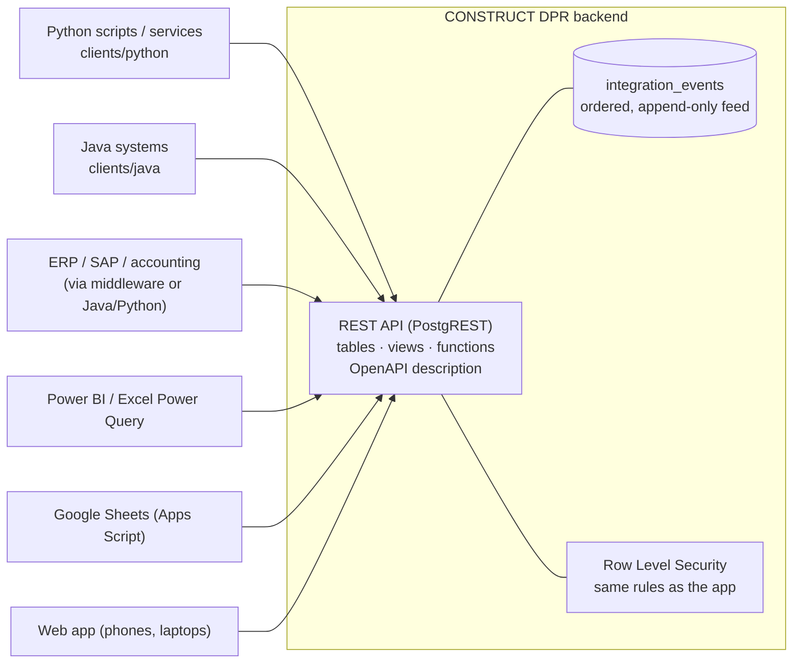

# Connecting other software (Python, Java, ERP/SAP, Excel, Power BI, Google Sheets)

CONSTRUCT DPR is built so that **any** program can work with its data through a standard HTTPS + JSON API. Nothing is locked inside the app.



## Why the core stays a web app (and where Java/Python fit)

* The field app must run in Chrome on Android phones, offline, with camera and microphone. Only JavaScript/TypeScript runs natively there, so the app is TypeScript, and the business rules live in the database (SQL), where every client must obey them.
* **Python** is best for automation, analytics, Excel reports, data migration and scheduled jobs.
* **Java** is best for enterprise integration (ERP, SAP middleware, corporate services).
* Both connect to the **same API with the same permissions**, so there is one source of truth and no second copy of the business rules.

## 1. Create an integration account (once per external system)

1. Sign up a dedicated user, e.g. `erp-bot@yourcompany.com`, with a strong password stored in your secret manager.
2. In the app: *Projects → Setup → Members & roles* → add that e-mail with role **Integration**.

| Integration role can | Cannot |
|---|---|
| read and export every module of that project | see other projects |
| create/update activities, WBS, areas, equipment, materials (master sync) | create, submit, approve or reject DPRs |
| update schedule dates and calendars | authorise BOQ quantity/rate revisions |
| update BOQ measured / certified / billed quantities | manage members |
| read the event feed | delete anything |

> **Never** use the Supabase `service_role` key in an integration. It bypasses every permission check and the audit trail would not show who acted.

## 2. Authenticate

```http
POST {SUPABASE_URL}/auth/v1/token?grant_type=password
apikey: {ANON_KEY}
Content-Type: application/json

{"email": "erp-bot@yourcompany.com", "password": "…"}
```
The response contains `access_token` (valid ~1 hour) and `refresh_token`. Send on every call:
```
apikey: {ANON_KEY}
Authorization: Bearer {access_token}
```
Refresh with `grant_type=refresh_token` and body `{"refresh_token": "…"}`. The Python and Java clients do this automatically.

## 3. What you can read and call

Base URL: `{SUPABASE_URL}/rest/v1/`. Filters use PostgREST syntax: `?project_id=eq.<uuid>&report_date=gte.2026-10-01&order=report_date.desc&limit=100`. The full machine-readable description (OpenAPI) is served at the base URL.

| Need | Endpoint |
|---|---|
| Projects | `GET projects` |
| Activities (with planned/actual dates) | `GET activities?project_id=eq.…` |
| Progress per activity (accepted quantities) | `GET activity_progress?project_id=eq.…` |
| BOQ with contract / executed / certified / billed amounts | `GET boq_status?project_id=eq.…` |
| DPR list | `GET dpr_headers?project_id=eq.…&status=eq.approved` |
| One complete DPR | `POST rpc/dpr_document` `{"p_id": "…"}` |
| Approved, immutable report snapshots (+ SHA-256) | `GET report_revisions?project_id=eq.…` |
| Daily manpower / equipment | `GET manpower_daily`, `GET equipment_daily` |
| Store stock | `GET material_stock` |
| Registers | `GET safety_observations`, `inspection_records`, `quality_ncrs`, `constraints`, `action_items` |
| Everything at once (JSON) | `POST rpc/export_project` `{"p_project": "…"}` |
| Create/update activities by code | `POST activities?on_conflict=project_id,code` with header `Prefer: resolution=merge-duplicates` |
| Update billing fields | `PATCH boq_items?id=eq.…` `{"certified_qty": …, "billed_qty": …}` (billed ≤ certified is enforced) |

Money is returned as decimal numbers in project currency (₹); quantities in each item's unit; timestamps in UTC (ISO 8601); report dates are project-local dates.

## 4. Event feed — react to what happens on site

`GET integration_events?id=gt.{last_id}&order=id&limit=500`

| event_type | When | payload |
|---|---|---|
| `dpr.submitted`, `dpr.under_review`, `dpr.approved`, `dpr.rejected` | DPR status changes | dpr_no, revision, report_date, shift, from_status |
| `dpr.revision_started` | correction of an approved DPR begins | + previous_revision_id, reason |
| `report.snapshot_created` | approval froze the report | dpr_id, dpr_no, revision, snapshot_sha256 |
| `report.pdf_published` | approved PDF stored in Drive | drive_file_id, pdf_sha256 |
| `boq.revised` | authorised BOQ quantity/rate change | item_no, old/new qty and rate, reason |
| `baseline.frozen` | new schedule baseline | revision_no, name |
| `activity.created`, `activity.status_changed` | activity master changes | code, from/to, actual dates |
| `ncr.opened/in_progress/closed`, `safety.opened/…` | register entries created directly or status changes | description, status |

**How to consume it reliably**
1. Store the last processed `id` (the cursor) in a file or table.
2. Ask for `id > cursor`, oldest first; handle each event; save the cursor **after** handling.
3. Make your handling idempotent (e.g. key ERP postings on `dpr_no + revision + activity`), because a crash between "handled" and "cursor saved" replays one event.
4. Poll every 30–60 s, or subscribe to the `integration_events` table over Supabase Realtime for push delivery.

Events are append-only and never deleted by the app, so a consumer that was down for a week catches up completely.

## 5. Python

```bash
cd clients/python && pip install .          # or just copy the construct_dpr folder — no dependencies
export CDPR_URL=https://xyz.supabase.co CDPR_ANON_KEY=… CDPR_EMAIL=erp-bot@… CDPR_PASSWORD=…
python -m construct_dpr projects
python -m construct_dpr progress DEMO-BF2 -o progress.csv
python -m construct_dpr boq DEMO-BF2 -o boq.csv
python -m construct_dpr export DEMO-BF2 -o backup.json
python -m construct_dpr import-activities DEMO-BF2 activities.csv
python -m construct_dpr events --after 0 --follow
```
Examples: `clients/python/examples/erp_sync.py` (forward approved quantities), `weekly_excel.py` (management workbook).

## 6. Java

```bash
cd clients/java && ./build.sh test      # builds target/construct-dpr-client.jar (Java 11+, no dependencies)
```
```java
var api = new ConstructDprClient(url, anonKey);
api.signIn("erp-bot@company.com", password);
String approved = api.select("dpr_headers", Map.of("project_id", "eq." + projectId, "status", "eq.approved"));
String doc = api.dprDocument(dprId);       // JSON — parse with Jackson/Gson
```
Example: `clients/java/examples/EventFollower.java`.

## 7. Excel / Power BI (no code)

*Data → Get Data → From Web → Advanced*: URL `{SUPABASE_URL}/rest/v1/activity_progress?project_id=eq.<id>`, headers `apikey` and `Authorization: Bearer <token>`. Tokens expire after ~1 hour, so for scheduled refresh run the Python CLI (`progress`/`boq` → CSV) on a timer and point Excel/Power BI at the CSV folder.

## 8. Google Sheets (Apps Script)

```javascript
function refreshBoq() {
  const P = PropertiesService.getScriptProperties();        // store URL, ANON_KEY, EMAIL, PASSWORD here
  const auth = JSON.parse(UrlFetchApp.fetch(P.getProperty('URL') + '/auth/v1/token?grant_type=password', {
    method: 'post', contentType: 'application/json', headers: { apikey: P.getProperty('ANON_KEY') },
    payload: JSON.stringify({ email: P.getProperty('EMAIL'), password: P.getProperty('PASSWORD') }) }));
  const rows = JSON.parse(UrlFetchApp.fetch(P.getProperty('URL') + '/rest/v1/boq_status?project_id=eq.' + P.getProperty('PROJECT_ID') + '&order=item_no',
    { headers: { apikey: P.getProperty('ANON_KEY'), Authorization: 'Bearer ' + auth.access_token } }));
  const sh = SpreadsheetApp.getActive().getSheetByName('BOQ');
  sh.clearContents();
  sh.appendRow(['Item', 'Description', 'Unit', 'Approved qty', 'Executed qty', 'Contract ₹', 'Executed ₹', 'Certified ₹', 'Billed ₹']);
  rows.forEach(r => sh.appendRow([r.item_no, r.description, r.unit, r.approved_qty, r.executed_qty, r.contract_amount, r.executed_amount, r.certified_amount, r.billed_amount]));
}
```
Add a time-driven trigger (e.g. hourly). Sheets remains a **report**, not the system of record.

## 9. Good practice

* One integration account per external system; rotate passwords; deactivate accounts that are no longer used (*Members → Deactivate*).
* Respect limits: page with `limit`/`offset` (≤ 1000 rows), poll no faster than every 30 s, back off on HTTP 429/503 (the clients do).
* Writes are validated exactly like the app's: errors come back as HTTP 4xx with a readable message (`409` conflict, `403` permission, `422` business-rule violation).
* Every write by an integration account is in the audit log under that account.
