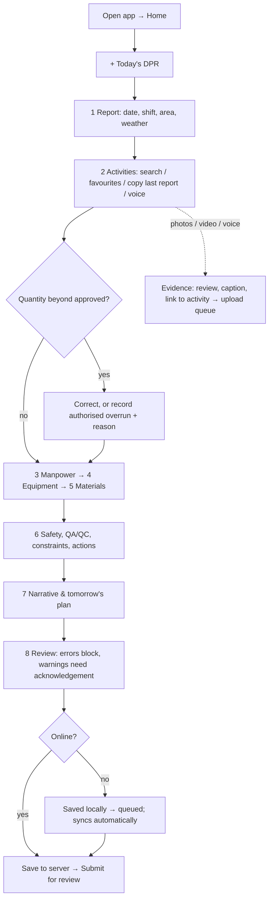
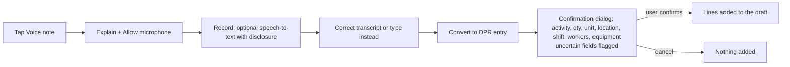
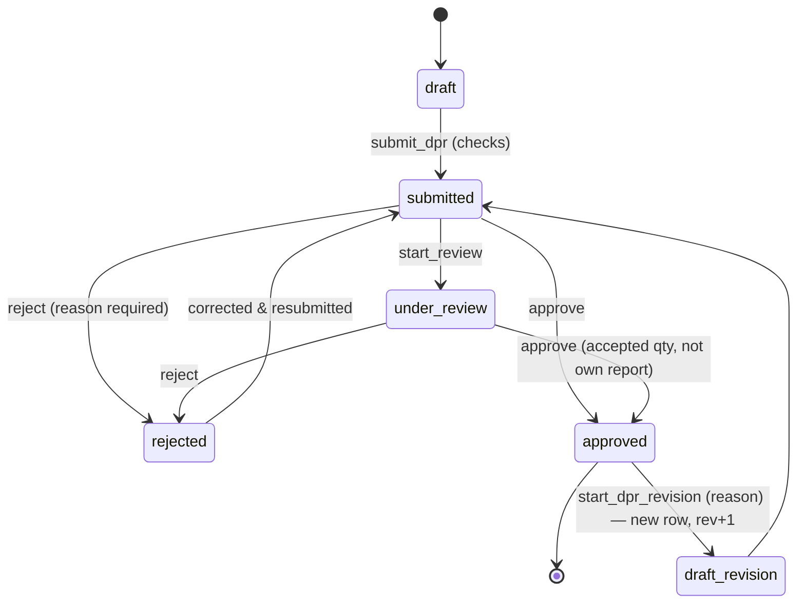
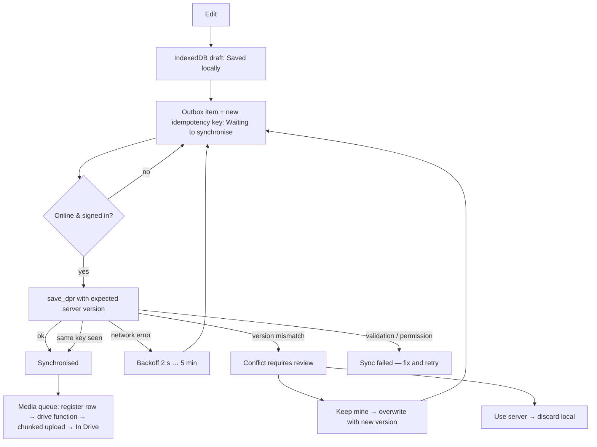

# User workflows

## Daily reporting (site engineer, on a phone)

## Voice entry

## Review and approval

On approval the database: freezes accepted quantities, updates activity actual dates/status, writes an immutable JSON snapshot with SHA-256 into `report_revisions`. The PDF is built from that snapshot and published to Drive (`04_DPR/YYYY/MM/Approved PDFs`), and its file ID and checksum are attached to the revision once.

## Offline synchronisation

## Planning (planning engineer)

1. Setup → WBS, areas, activities (or CSV import), calendar and holidays.
2. Schedule → add FS/SS/FF/SF links with lags → review CPM (dates, floats, critical path).
3. *Apply dates to plan* (version-checked) → *Freeze baseline* → mark as approved baseline.
4. Daily: actuals arrive from approved DPRs; Schedule shows forecast vs baseline variance; Dashboards show S-curve.
5. Re-baseline only by freezing a new revision — the old one stays.
