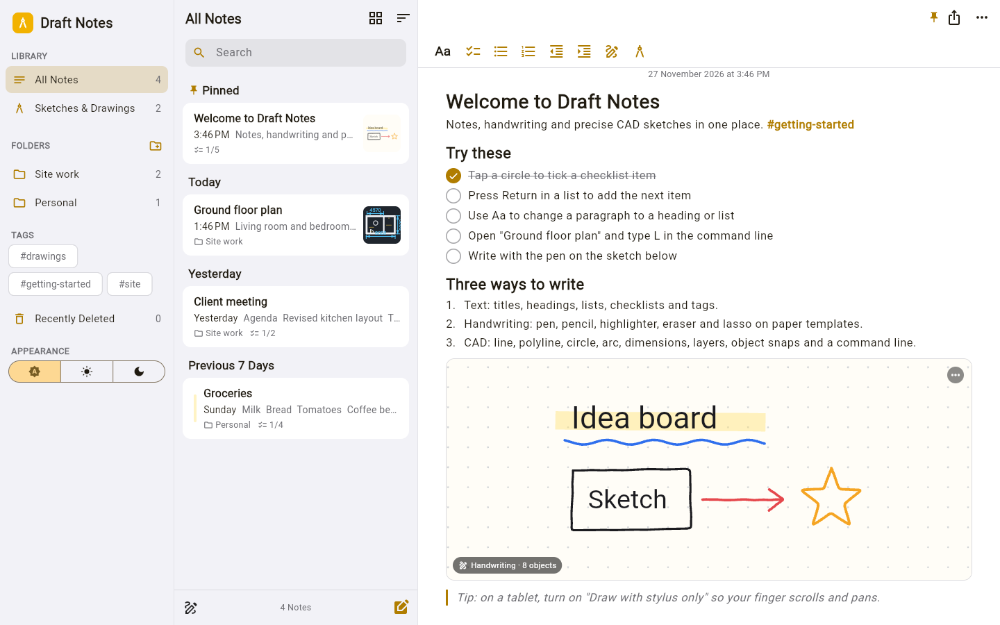
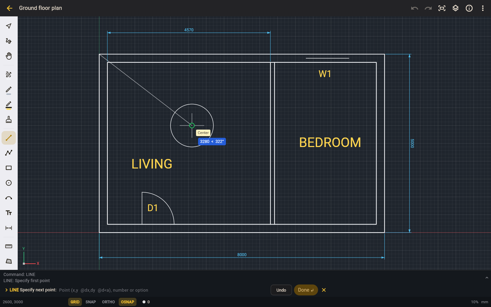
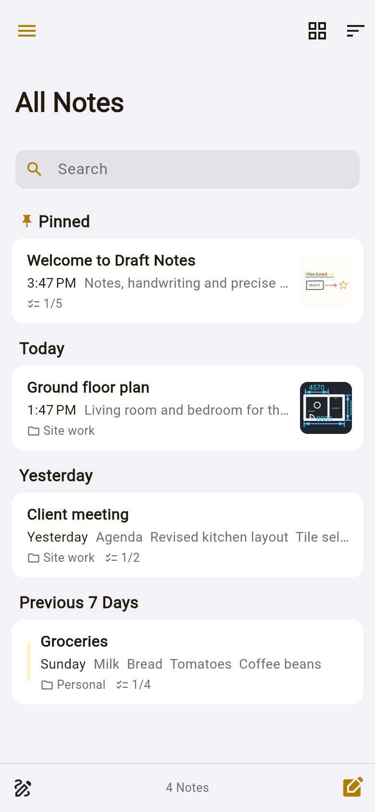
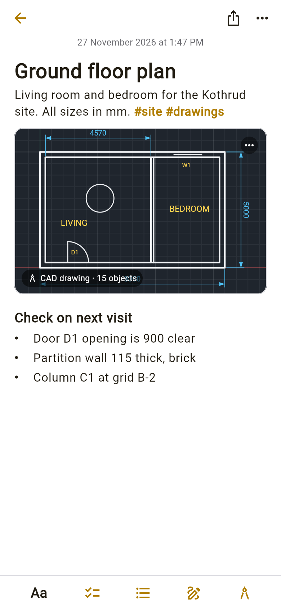
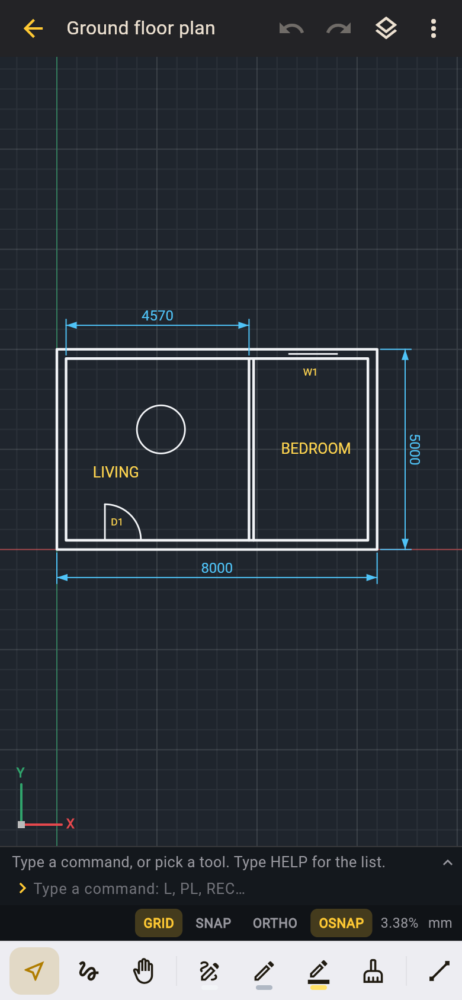

# Draft Notes – notes, handwriting and CAD sketches

A Flutter note app for Android, iOS, Windows and the web. It combines three styles of note taking in one place:

| Inspired by | What you get |
|---|---|
| **Apple Notes** | Folders, "All Notes", pinned notes, Today / Yesterday / Previous 7 Days groups, search, list and gallery views, the first line as title, paragraph styles (Title, Heading, Subheading, Body, Monostyled), bulleted / dashed / numbered lists, round checklists, `#tags`, Recently Deleted (kept for 30 days), swipe to pin or delete |
| **Samsung Notes** | Handwriting pages on plain, lined, squared or dotted paper; pen (with stylus pressure), pencil and highlighter with colour swatches and thickness; eraser by area or by stroke; lasso select and move; "draw with stylus only" so fingers scroll; note colours |
| **AutoCAD** | Dark model space with an adaptive grid and UCS icon, a **command line** (`L`, `PL`, `REC`, `C`, `A`, `T`, `DIM`, `M`, `CO`, `RO`, `SC`, `MI`, `O`, `E`, `DI`, `AA`, `Z E`, `U`…), typed coordinates (`x,y`, `@dx,dy`, `@dist<angle`, direct distance), **GRID / SNAP / ORTHO / OSNAP** toggles (F7 / F9 / F8 / F3), object snaps (endpoint, midpoint, centre, quadrant, intersection), window and crossing selection, grips, layers (colour, on/off, lock), properties with lengths and areas, aligned dimensions, units and precision, and **DXF export** that opens in AutoCAD, LibreCAD, QCAD and DraftSight |

| Desktop: folders, list and note | CAD canvas: command line, object snap, dimensions |
|---|---|
|  |  |

| Phone: notes | Phone: note with a CAD sketch | Phone: drawing canvas |
|---|---|---|
|  |  |  |

Every note can mix text and any number of sketches. A sketch opens full screen in the drawing canvas, where the handwriting tools and the CAD tools work side by side.

## Download

From the [Releases page](https://github.com/garthag/parthag/releases), open the newest **Draft Notes build**:

| File | For |
|---|---|
| `DraftNotes-Setup.exe` | Windows 10 / 11: run it to install (no admin rights needed). If Windows shows "Windows protected your PC", click **More info → Run anyway**, because the app isn't code-signed. |
| `DraftNotes-windows.zip` | Windows, portable: extract it and run `draft_notes.exe` in the `DraftNotes` folder |
| `DraftNotes-android.apk` | Android phones and tablets |

## Using it

**Notes**
- The compose button (bottom right) starts a note. The pen button (bottom left) starts a handwriting note or a CAD drawing.
- In a note, `Aa` changes the paragraph style. Return in a list adds the next item; Return on an empty item ends the list. Backspace at the start of a list item removes the bullet. Tab / Shift+Tab indents list items.
- Type `#something` anywhere to tag a note; tags appear in the sidebar.
- Long-press (or right-click) a note in the list for pin, colour, move, duplicate, share and delete. On phones, swipe right to pin and left to delete.

**Drawing canvas**
- Pinch or scroll to zoom, two fingers or the middle mouse button to pan, `Zoom extents` to fit the drawing.
- Pick a tool on the left (desktop) or the bottom (phone). Tap the active pen again for colours and size.
- CAD tools work the AutoCAD way: click or tap each point, or drag from the first point to the second. `Done` (Enter, Space or right-click) finishes, `Esc` cancels. Typing anywhere on the canvas goes to the command line.
- Select with a tap, or drag a window: left-to-right selects objects fully inside, right-to-left also selects objects it crosses. Drag a blue grip to reshape, drag the object to move it, and use the action bar for Move, Copy, Rotate, Scale, Mirror, Duplicate, Colour and Delete.
- `⋮` → *Paper, units & grid* switches paper (model space, blueprint, plain, lined, squared, dotted), units (mm, cm, m, in, ft), precision, grid spacing and text height.
- `⋮` → *Share as PNG / SVG / DXF* exports the sketch.

## Project layout

```
lib/
  main.dart                 app, theme mode, save on pause
  models/note.dart          notes, folders, paragraph blocks, tags, Markdown
  models/drawing.dart       drawing, layers, ink strokes, lines, polylines,
                            circles, arcs, text and dimensions (world Y up)
  cad/geometry.dart         intersections, offsets, areas, transforms
  cad/command_parser.dart   AutoCAD style point input and command aliases
  cad/commands.dart         LINE, PLINE, RECTANG, CIRCLE, ARC, TEXT, DIM,
                            DIST, AREA, MOVE, COPY, ROTATE, SCALE, MIRROR,
                            OFFSET, ZOOM
  cad/canvas_controller.dart  tools, pointer/pinch/stylus input, snaps,
                            selection, grips, eraser, undo/redo
  cad/painter.dart          grid, paper, objects, previews, snap markers
  cad/exporters.dart        DXF R12, SVG and PNG
  data/notes_store.dart     folders, smart folders, search, sorting, bin
  data/storage*.dart        JSON file storage (local storage on the web)
  ui/                       home (1/2/3 panes), note editor, canvas screen
```

Notes are kept offline as one JSON file in the app's documents folder.

## Build and test

```bash
cd draft_notes
flutter pub get
flutter analyze
flutter test
flutter run                  # or: flutter build apk / windows / web
```

The `Draft Notes` workflow (`.github/workflows/draft-notes.yml`) runs the analyzer and tests, then builds `DraftNotes-android.apk`, `DraftNotes-windows.zip` and the `DraftNotes-Setup.exe` installer (`installer/draft_notes.nsi`, built with NSIS). On each push it publishes them on the [Releases page](https://github.com/garthag/parthag/releases) as **Draft Notes build N**.
